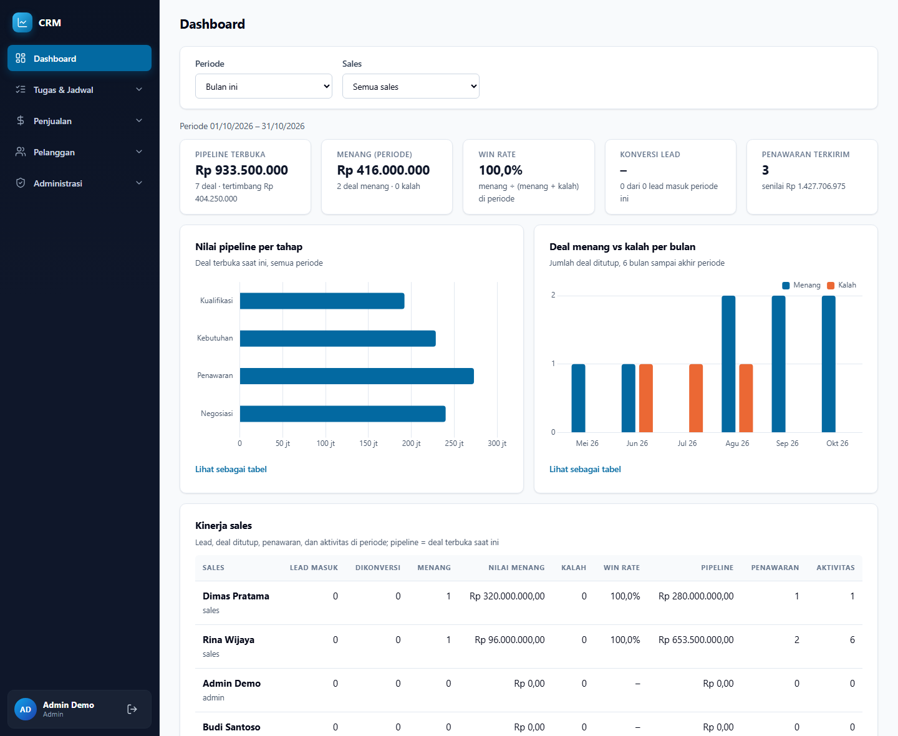
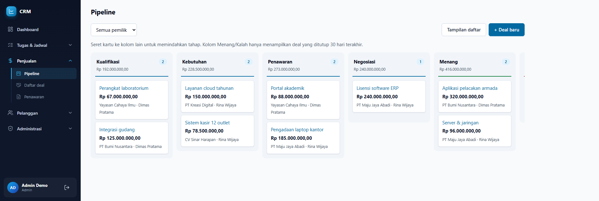
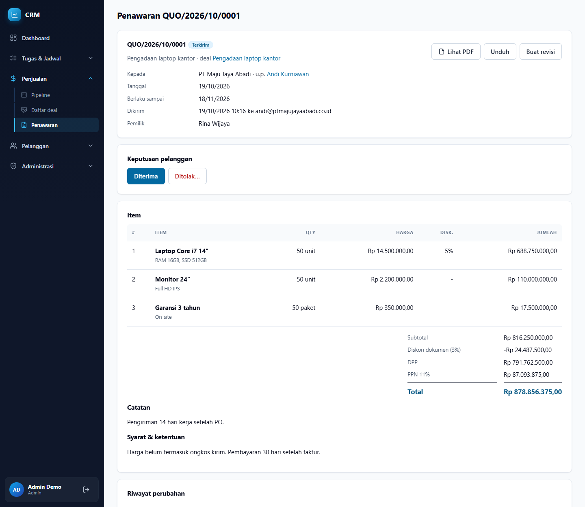
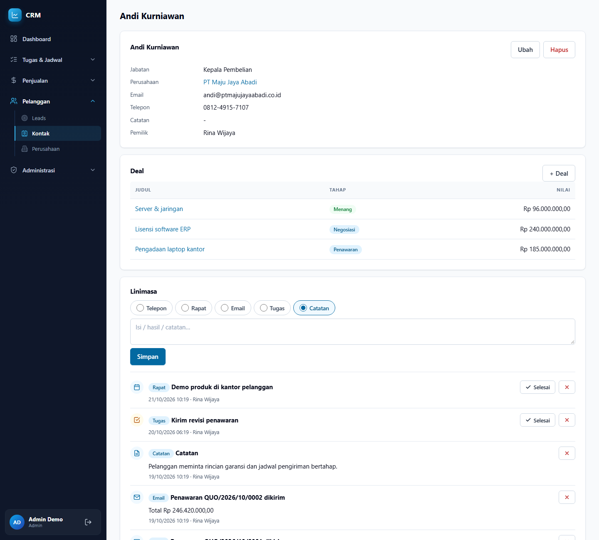
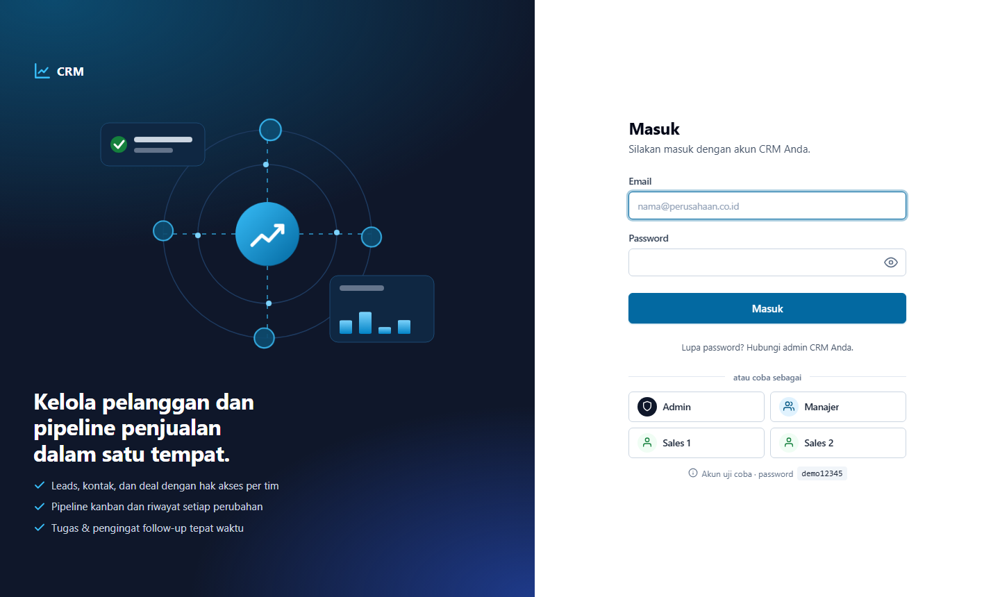

# Project CRM

CRM ringan berbahasa Indonesia untuk tim sales B2B. Mengelola **leads, kontak, perusahaan, pipeline deal (kanban), penawaran PDF, tugas, dan dashboard** dalam satu aplikasi kecil yang mudah dijalankan: **Node.js + Express + EJS + HTMX + PostgreSQL**, tanpa tahap build dan tanpa ORM.



## Fitur

| Area | Yang tersedia |
|---|---|
| **Pengguna & hak akses** | Login aman (JWT di signed cookie), tiga peran: **admin** (semua data), **manajer** (data timnya), **sales** (hanya data miliknya). Hak akses diperiksa di route **dan** di setiap query SQL. |
| **Leads** | Sumber lead, status, penugasan pemilik, peringatan **duplikat** email/telepon (tanpa penggabungan otomatis), dan **konversi lead** menjadi kontak + perusahaan + deal dalam satu transaksi. |
| **Kontak & perusahaan** | Pencarian langsung, paginasi, soft delete, riwayat perubahan, dan deal terkait. |
| **Deal & pipeline** | Tampilan **kanban seret-lepas**, tahap dikelola dari pengaturan, setiap perpindahan tahap tercatat (siapa, kapan, dari-ke), menang/kalah dengan alasan. |
| **Aktivitas & linimasa** | Telepon, rapat, email, tugas, dan catatan. Linimasa gabungan per kontak/deal/lead, tugas dengan tenggat dan penanggung jawab. |
| **Penawaran** | Nomor berurutan `QUO/2026/10/0001`, item bebas, diskon per baris & dokumen, PPN, **PDF** (pdfmake), kirim email, status Draf → Terkirim → Diterima/Ditolak, **revisi** (`-R1`, `-R2`). Diterima otomatis memindahkan deal ke Menang. |
| **Dashboard** | Pipeline terbuka (termasuk nilai tertimbang), menang, win rate, konversi lead, grafik per tahap dan tren menang/kalah, kinerja per sales. Filter periode dan sales. |
| **Pengaturan (admin)** | Nama perusahaan, PPN, batas diskon, masa berlaku penawaran, tahap pipeline, dan sumber lead. |
| **Jejak audit** | Siapa, kapan, dan kolom apa yang berubah. Isi data pribadi pelanggan tidak ditulis ke log. |

### Rencana berikutnya
Impor/ekspor CSV, notifikasi di aplikasi, lampiran file, dan worker (pengingat tugas terjadwal).

## Tangkapan layar

**Pipeline kanban**: seret kartu ke kolom lain untuk memindahkan tahap.



**Penawaran**: total, diskon, dan PPN dihitung di database dari baris item.



**Kontak dan linimasa**: catatan, telepon, rapat, tugas, dan penawaran dalam satu urutan waktu.



**Halaman masuk** dengan akun demo per peran.



## Teknologi

| Lapisan | Pilihan |
|---|---|
| Runtime | Node.js (≥ 20) |
| Server | Express 4 |
| Tampilan | EJS di server, **HTMX** + **Alpine.js** (file `.js` statis), CSS tulisan tangan |
| Database | PostgreSQL, akses lewat `pg` dan SQL murni (tanpa ORM) |
| Migrasi | File SQL bernomor + `scripts/migrate.js` |
| Auth | `jsonwebtoken` + `cookie-parser`, password `bcryptjs`, proteksi CSRF |
| PDF & email | `pdfmake` (font bawaan, tidak disimpan ke disk), `nodemailer` |
| Grafik | `chart.js` |
| Tes | `node:test` bawaan Node, tanpa devDependencies |

Tidak ada Webpack/Vite/Babel/TypeScript dan tidak ada library yang butuh kompilasi native. Ukuran `node_modules` ±53 MB.

## Menjalankan di komputer sendiri (Windows + PowerShell)

Prasyarat: **Node.js ≥ 20** dan **PostgreSQL**.

```powershell
# 1. Pasang dependency
npm install --omit=dev

# 2. Buat file pengaturan lalu isi password database dan dua rahasia acak
Copy-Item .env.example .env
notepad .env

# 3. Buat database (aplikasi dan tes)
createdb -U postgres crm
createdb -U postgres crm_test

# 4. Buat tabel
npm run migrate

# 5. Buat akun admin pertama
node scripts/seed.js admin@contoh.local "Nama Admin" passwordRahasia

# 6. Jalankan (restart otomatis saat kode berubah)
npm run dev
```

Buka <http://localhost:3000>.

> Isi `JWT_SECRET` dan `COOKIE_SECRET` di `.env` dengan teks acak yang panjang (minimal 32 karakter). Jangan pernah mengunggah file `.env`; file ini sudah ada di `.gitignore`.

### Akun demo (opsional)

Untuk mencoba hak akses per peran, isi `DEMO_LOGIN=1` di `.env`, lalu:

```powershell
npm run seed:demo
```

Halaman login akan menampilkan tombol **Admin**, **Manajer**, **Sales 1**, dan **Sales 2** (password semua akun: `demo12345`). Fitur ini **otomatis mati** bila `NODE_ENV=production`. Jangan dipakai di server sungguhan.

### Email

Selama `SMTP_HOST` kosong, email penawaran hanya dicatat ringkas di konsol (alamat penerima disamarkan). Isi `SMTP_*` di `.env` untuk mengirim email sungguhan.

## Perintah npm

| Perintah | Fungsi |
|---|---|
| `npm start` | Menjalankan server |
| `npm run dev` | Menjalankan server dengan restart otomatis |
| `npm run migrate` | Menjalankan migrasi SQL yang belum dijalankan |
| `npm run seed:demo` | Membuat akun demo |
| `npm test` | Menjalankan seluruh tes (memakai database `crm_test`) |

## Aturan bisnis penting

- **Uang** disimpan `NUMERIC(15,2)` dan dihitung di SQL, tidak pernah memakai float JavaScript.
- **Transaksi:** operasi yang menyentuh lebih dari satu tabel (konversi lead, nomor penawaran, deal diterima → menang) berjalan dalam satu `BEGIN … COMMIT` dengan `ROLLBACK` bila gagal.
- **Nomor penawaran** diambil dengan `SELECT … FOR UPDATE` pada tabel penghitung, sehingga tidak pernah ganda walau dibuat bersamaan. Penawaran yang sudah dikirim tidak bisa diubah; perubahan dibuat sebagai revisi baru.
- **Soft delete:** setiap tabel punya `deleted_at`, data tidak dihapus permanen dari tampilan "hapus".
- **Tahap pipeline** disimpan di tabel, bukan ditulis mati di kode.
- Perubahan skema hanya lewat file migrasi bernomor di folder `migrations/`; migrasi lama tidak diedit.

## Struktur folder

```
migrations/        file SQL bernomor (001_init.sql, ...)
scripts/           migrate.js, seed.js, seed-demo.js
src/
  app.js, server.js
  config/          env.js, db.js (helper transaksi), demo.js
  middleware/      auth.js, akses.js, csrf.js, error.js
  modules/crm/     routes.js, controllers/ (tanpa SQL), services/ (semua SQL di sini)
  views/           partials/ (layout, sidebar, ikon), crm/*.ejs
public/            css/, js/ (htmx, alpine, chart.js, app.js)
tests/             tes node:test (jalankan dengan npm test)
docs/screenshots/  gambar untuk README
```

## Keamanan singkat

Password di-hash dengan bcrypt; sesi memakai cookie bertanda tangan `httpOnly`; formulir dilindungi token CSRF; header keamanan dari `helmet`; percobaan login dibatasi; pengguna yang dinonaktifkan langsung kehilangan sesi; data milik pengguna lain dijawab 404 agar keberadaannya tidak bocor.
